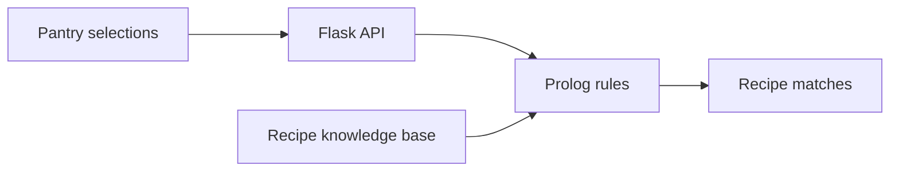

# Nutrition Expert

**A recipe recommendation app that combines a Flask interface with Prolog rules.**

Choose ingredients, set a time limit, and select dietary preferences. Flask sends those inputs to SWI-Prolog through PySwip, where rules match them against a recipe and ingredient knowledge base. The interface displays matching recipes and available nutrition details.



## Run locally

Install Python and SWI-Prolog. From the repository root, create and activate a Python virtual environment, then run:

```bash
python -m pip install -r requirements.txt
python app.py
```

Open `http://127.0.0.1:5000`. Choose ingredients, set the maximum preparation time, and request recommendations. The Flask entry point starts a local development server.

To try the API directly, use ingredient identifiers from `knowledge_base.pl` in the `fridge` array:

```bash
curl -X POST http://127.0.0.1:5000/api/suggest \
  -H 'Content-Type: application/json' \
  -d '{"fridge":["tomato"],"max_time":30,"allergy":"none","diet":"any"}'
```

Results depend on the combination of ingredients and constraints. Nutrition and dietary filters reflect the knowledge base’s recorded values and tags.

| Path | Role |
| --- | --- |
| `app.py` | Flask routes and the Prolog bridge |
| `rules.pl` | Recommendation and filtering logic |
| `knowledge_base.pl` | Ingredient and recipe facts |
| `templates/`, `static/` | Browser interface and recipe detail views |
